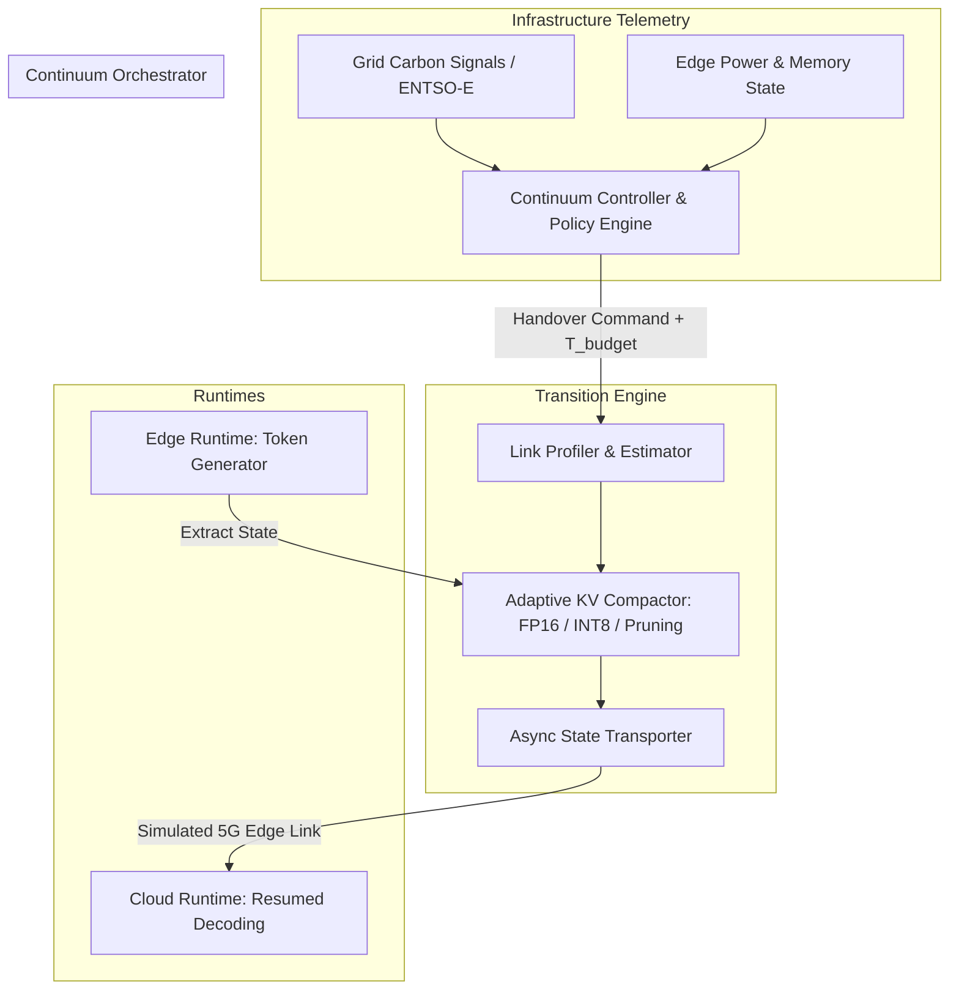

# ContinuumKV: Budget-Constrained Stateful KV-Cache Handover for Edge-to-Cloud LLM Serving

[](https://www.python.org/downloads/)
[](https://opensource.org/licenses/MIT)
[]()

**ContinuumKV** is an experimental systems prototype and benchmark suite investigating **stateful session mobility for Large Language Model (LLM) inference** across the edge-to-cloud computing continuum.

Existing distributed LLM serving frameworks (e.g., *Splitwise*, *DistServe*, *Mooncake*) assume high-bandwidth, low-latency datacenter fabrics (RDMA/InfiniBand) and typically restrict state migration to prompt boundaries. In contrast, running LLMs on resource-constrained edge devices (such as 5G private edge nodes, robotics, or on-device NPUs) requires **dynamic workload mobility during active autoregressive generation** to handle:
1. **Local memory and thermal saturation** during long token sequences.
2. **Volatile infrastructure and power grid conditions** (e.g., fluctuating renewable energy, local carbon intensity spikes, and strict device energy caps).
3. **Variable network uplinks** (5G RAN / constrained WAN) that penalize raw tensor transfer.

ContinuumKV tackles the fundamental trade-off between **state migration downtime** and **cold prompt recomputation (re-prefill)** under strict, user-defined SLA time budgets ($T_{\text{budget}}$).

---

## Architecture Overview

ContinuumKV implements a three-tier continuum middleware architecture:



### Core Components
- **Inference Worker Runtime (`core/worker.py`):** Autoregressive token generator supporting dynamic extraction and injection of PyTorch `past_key_values` attention tensors without restarting sequence prefill.
- **Adaptive Compactor (`core/serializer.py`):** Dynamically applies precision scaling (FP16 $\to$ INT8/INT4) and token pruning to guarantee the state payload transfers within the target deadline ($T_{\text{budget}}$).
- **Network Simulator (`core/network_sim.py`):** Accurate continuum link emulation modeling transmission delays across 5G edge uplinks, constrained WANs, and datacenter interconnects.
- **Continuum Controller (`core/controller.py`):** Decoupled policy engine evaluating multi-objective triggers from grid carbon traces (`traces/sample_carbon_trace.json`) and device power envelopes.

---

## Grounding & Related Literature

This project bridges two previously separated domains:

1. **LLM KV-Cache Disaggregation & Compression:**
   - *Liu et al., "KV Cache Streaming for LLMs with CacheGen"*, **ACM SIGCOMM 2024**.
   - *Patel et al., "Splitwise: Efficient Generative LLM Inference Using Phase Splitting"*, **ISCA 2024**.
   - *Zhong et al., "DistServe: Disaggregating Prefill and Decoding for Goodput-Optimized LLM Serving"*, **OSDI 2024**.
   - *Qin et al., "Mooncake: A KVCache-centric Disaggregated Architecture for LLM Serving"*, **FAST 2025 / arXiv 2024**.
2. **Carbon-Aware & Edge-Cloud Continuum Systems:**
   - *Radovanović et al., "Carbon-Aware Computing for Datacenters"*, **IEEE Micro 2022**.
   - *Schulte et al., "Fog and Edge Computing: Principles and Paradigms"*, **Distributed Systems Literature**.

---

## Repository Structure

```text
├── README.md                      # Project documentation and architecture guide
├── requirements.txt               # Lightweight dependencies (runs on Apple Silicon / CPU)
├── .gitignore                     # Model weight and cache filters
├── core/                          # Core middleware implementation
│   ├── worker.py                  # Token generation loop + KV extraction & injection
│   ├── serializer.py              # KV-cache tensor compression & serialization
│   ├── network_sim.py             # Continuum network emulator (5G WAN / bandwidth)
│   └── controller.py              # Policy engine (SLA time budgets & grid triggers)
├── traces/                        # Trace datasets
│   ├── sample_carbon_trace.json   # Carbon intensity time-series trace
│   └── network_profiles.json      # Preset network continuum profiles
├── benchmarks/                    # Evaluation suite
│   ├── benchmark_handover.py      # Stateful migration vs. cold re-prefill evaluation
│   └── benchmark_budget_sla.py    # SLA adherence under constrained bandwidth
├── figures/                       # Evaluation plots and figures
├── run_demo.py                    # End-to-end interactive demo
└── reproduce_benchmarks.py        # 1-command benchmark reproduction
```

---

## Quickstart

### 1. Installation
Clone the repository and install the lightweight requirements (compatible with Apple Silicon M1/M2/M3 and standard x86):

```bash
git clone https://github.com/ines-benygzer/Stateful-kv-Cache-Migration.git
cd Stateful-kv-Cache-Migration
python3 -m venv venv
source venv/bin/activate
pip install -r requirements.txt
```

### 2. Run the Interactive Handover Demo
Simulates an edge-to-cloud stateful session handover triggered by an environmental grid signal:

```bash
python run_demo.py
```

### 3. Reproduce Benchmark Figures
Run the automated evaluation suite to generate the performance characterization figures:

```bash
python reproduce_benchmarks.py
```
Generated plots will be saved to `figures/`.

---

## Research Vision & Roadmap

This prototype represents preliminary research toward a formal **Grid-Aware Workload Mobility Middleware for the Computing Continuum**:
- [x] Proof-of-concept KV-cache extraction and resume runtime.
- [x] Adaptive state compaction under edge bandwidth constraints.
- [ ] Formal optimization model for multi-node continuum placement under dynamic electricity tariffs.
- [ ] Transition engine verification guaranteeing zero-violation SLA time budgets.
- [ ] Policy-enforced security boundaries and encrypted state transport over public continuum links.